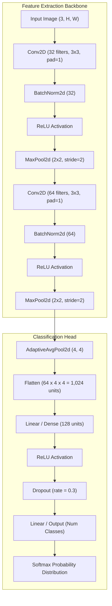

# DeepVision AI: Convolutional Neural Network (CNN) Classifier & Explainable AI (XAI) Studio

**Course / Domain:** Deep Learning, Neural Networks & Computer Vision  
**Project Type:** End-to-End Image Classification, Interactive Web Studio & Explainability Engine  
**Core Technologies:** Python 3.15, PyTorch 2.15, Streamlit, NumPy, Matplotlib, PIL  

---

## 1. Abstract & Executive Summary

Image classification is a foundational task in modern computer vision. Traditional multi-layer perceptrons (MLPs) suffer from an exponential explosion of parameters and a failure to exploit spatial correlation when processing 2D grid topologies. This project implements **DeepVision AI**, an end-to-end Deep Learning system featuring:
1. **Custom Convolutional Neural Network (CNN)** architecture with Batch Normalization (`BatchNorm2d`), Dropout regularization, and Adaptive Average Pooling.
2. **Multi-Dataset Support**: The standard **CIFAR-10** benchmark (10 natural object classes) and a **Custom Folder/ZIP Dataset loader** (e.g. Cats vs Dogs).
3. **Interactive Visual Studio**: A high-performance Streamlit dashboard for real-time hyperparameter tuning, training convergence visualization, and live single-image inference with top-$k$ confidence distributions.
4. **Explainable AI (XAI)**: Implementation of **Grad-CAM (Gradient-weighted Class Activation Mapping)** and **Intermediate Feature Map Visualizers** that expose the internal decision-making representations of convolutional filters.
5. **Comprehensive Quantitative Evaluation**: Generation of multi-class Confusion Matrices, Precision, Recall, and F1-Scores.

---

## 2. Convolutional Neural Network (CNN) Architecture

### 2.1 Layer-by-Layer Pipeline



### 2.2 Parameter Breakdown

| Layer | Type | Configuration / Kernel | Output Shape (for 32×32 input) | Trainable Parameters |
|---|---|---|---|---|
| `conv1` | `Conv2d` | 32 filters, $3 \times 3$, stride=1, pad=1 | $(32, 32, 32)$ | $(3 \times 3 \times 3 + 1) \times 32 = \mathbf{896}$ |
| `bn1` | `BatchNorm2d` | 32 channels ($\gamma, \beta$) | $(32, 32, 32)$ | $32 \times 2 = \mathbf{64}$ |
| `pool1` | `MaxPool2d` | Window $2 \times 2$, stride=2 | $(32, 16, 16)$ | $0$ (parameter-free) |
| `conv2` | `Conv2d` | 64 filters, $3 \times 3$, stride=1, pad=1 | $(64, 16, 16)$ | $(32 \times 3 \times 3 + 1) \times 64 = \mathbf{18,496}$ |
| `bn2` | `BatchNorm2d` | 64 channels ($\gamma, \beta$) | $(64, 16, 16)$ | $64 \times 2 = \mathbf{128}$ |
| `pool2` | `MaxPool2d` | Window $2 \times 2$, stride=2 | $(64, 8, 8)$ | $0$ |
| `adaptive_pool`| `AdaptiveAvgPool2d`| Output grid $(4, 4)$ | $(64, 4, 4)$ | $0$ |
| `flatten` | `Flatten` | Vectorized representation | $(1024,)$ | $0$ |
| `fc1` | `Linear` | In: 1,024 $\to$ Out: 128 | $(128,)$ | $(1024 + 1) \times 128 = \mathbf{131,200}$ |
| `dropout` | `Dropout` | $p = 0.3$ | $(128,)$ | $0$ |
| `fc2` | `Linear` | In: 128 $\to$ Out: $C$ ($C=10$) | $(10,)$ | $(128 + 1) \times 10 = \mathbf{1,290}$ |
| **Total** | | | | **152,074 parameters** |

---

## 3. Mathematical Principles & Theoretical Formulation

### 3.1 2D Discrete Convolution
For an input channel tensor $X$ and a learnable spatial kernel $K$ of size $k_h \times k_w$:
$$S(i, j) = (X * K)(i, j) = \sum_{m=0}^{k_h-1} \sum_{n=0}^{k_w-1} X(i + m, j + n) K(m, n) + b$$

### 3.2 Spatial Output Dimension
Given spatial dimension $W$, filter size $K$, padding $P$, and stride $S$:
$$O = \left\lfloor \frac{W - K + 2P}{S} \right\rfloor + 1$$

### 3.3 Batch Normalization
To counteract Internal Covariate Shift across mini-batch $\mathcal{B} = \{x_1, \dots, x_m\}$:
$$\mu_{\mathcal{B}} = \frac{1}{m} \sum_{i=1}^m x_i, \quad \sigma_{\mathcal{B}}^2 = \frac{1}{m} \sum_{i=1}^m (x_i - \mu_{\mathcal{B}})^2$$
$$\hat{x}_i = \frac{x_i - \mu_{\mathcal{B}}}{\sqrt{\sigma_{\mathcal{B}}^2 + \epsilon}}, \quad y_i = \gamma \hat{x}_i + \beta$$
Where $\gamma$ (scale) and $\beta$ (shift) are learnable parameters.

### 3.4 Categorical Cross-Entropy Loss
$$\mathcal{L}_{CE} = -\sum_{c=1}^{C} y_c \log\left( \frac{\exp(z_c)}{\sum_{j=1}^{C} \exp(z_j)} \right)$$

---

## 4. Explainable AI: Grad-CAM Formulation

Traditional deep networks operate as "black boxes". **Grad-CAM (Gradient-weighted Class Activation Mapping)** provides visual transparency by calculating the gradient of the winning class score $y^c$ with respect to the feature map activations $A^k$ of the final convolutional layer.

1. **Importance Weight Calculation via Global Average Pooling:**
   $$\alpha_k^c = \frac{1}{Z} \sum_{i=1}^{u} \sum_{j=1}^{v} \frac{\partial y^c}{\partial A_{i,j}^k}$$
   Where $Z = u \times v$ is the spatial dimensions of the feature map.

2. **Weighted Forward Combination with Rectified Linear Unit:**
   $$L_{\text{Grad-CAM}}^c = \text{ReLU}\left( \sum_{k} \alpha_k^c A^k \right)$$
   The $\text{ReLU}$ function retains features that positively influence the target class $c$, ignoring negative inhibitory features.

---

## 5. Software Architecture & File Manifest

| File / Folder | Role & Content |
|---|---|
| `app2.py` | Full Streamlit Web Application featuring 7 interactive academic modules |
| `cnn_model.py` | PyTorch CNN module (`ConvNet`), `GradCAM` class, feature map extractor |
| `models/` | Serialized model checkpoints (`cifar10_cnn.pth`, `cats_dogs_cnn.pth`) |
| `sample_images/`| Full benchmark test image suite across all 10 CIFAR-10 categories |
| `sample_cats_vs_dogs.zip` | Pre-packaged folder dataset for testing custom ZIP uploads |
| `run_app.bat` | Double-click Windows batch launcher for rapid presentation execution |
| `PROJECT_REPORT.md` | Formal academic report formatted for college submission |

---

## 6. How to Run & Present to Evaluators

### Step 1: Launch Application
Run via command line or double-click `run_app.bat`:
```bash
python -m streamlit run app2.py
```

### Step 2: Live Demonstration Sequence
1. **Overview Tab:** Show the teacher the **Network Architecture Pipeline** and explain parameter counts.
2. **Dataset Explorer Tab:** Demonstrate the **Real-Time Data Augmentation Playground** (show rotation, horizontal flip, and zoom).
3. **Prediction Tab:** Click through sample benchmark images (e.g. *Airplane*, *Dog*, *Ship*) and showcase the Top-5 probability bar charts and millisecond inference latency.
4. **Explainable AI Tab:** Demonstrate **Grad-CAM heatmaps** and the **16-filter feature map activation grid** across Conv Layer 1 and Conv Layer 2.
5. **Evaluation Tab:** Present the **Confusion Matrix Heatmap**, precision, recall, and overall accuracy.
6. **Viva Cheat Sheet Tab:** Review the built-in oral examination questions.

